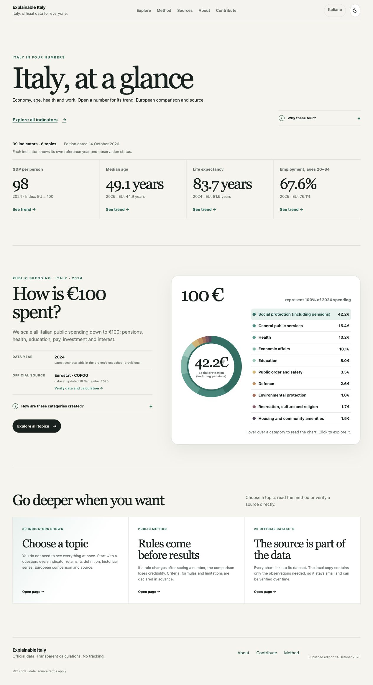

# Explainable Italy

You are reading the English version. Switch to **[Italiano](README.it.md)**. 

**Website:** **[Italiano](https://andrea-gentilini.github.io/explainable-italy/) · [English](https://andrea-gentilini.github.io/explainable-italy/en/)**

Explainable Italy makes official statistics about Italy easier to read, compare and verify: **39 indicators across 6 themes** built from **20 official Eurostat datasets** (and the EEA for greenhouse-gas emissions), with EU comparisons, historical series since 2000 and SHA256-verified source snapshots. It is an independent, open-source project (version **1.0.0**), with Italian as the default site language and a complete English edition.



---

<a id="english"></a>

## Where to start

| Audience | What you need | Where to go |
| --- | --- | --- |
| **Visitors & readers** | Browse the 39 indicators, understand comparisons and caveats, check privacy | [Italian site (default)](https://andrea-gentilini.github.io/explainable-italy/) · [English site](https://andrea-gentilini.github.io/explainable-italy/en/) · [How to read the comparisons](#for-visitors--explore-and-read-the-comparisons) |
| **Data reusers & researchers** | Download CSV/JSON series, verify raw Eurostat snapshots and SHA256 checksums, check reuse terms | [Sources & downloads page](https://andrea-gentilini.github.io/explainable-italy/en/sources/) · [`data/manifest.json`](data/manifest.json) · [`docs/METHODOLOGY.md`](docs/METHODOLOGY.md#english) · [`DATA_LICENSE.md`](DATA_LICENSE.md#english) |
| **Technical contributors** | Run and test the project locally, inspect the data pipeline, review automated refreshes | [Run locally](#run-locally) · [`CONTRIBUTING.md`](CONTRIBUTING.md) · [`docs/DATA_REFRESH.md`](docs/DATA_REFRESH.md) · [`SECURITY.md`](SECURITY.md#english) |

---

## For visitors — Explore and read the comparisons

The six themes cover **public spending**, **population**, **work and the economy**, **welfare and health**, **education**, and **environment and energy**. You can search in everyday language, pick any available year, inspect the full historical series as a chart or accessible table, and open each indicator’s verification page to inspect definitions, national observations and source quality flags. Shareable URLs preserve the selected year and search context.

For example, open [life expectancy in 2010](https://andrea-gentilini.github.io/explainable-italy/en/data/life-expectancy/?year=2010) and [verify its source and calculation](https://andrea-gentilini.github.io/explainable-italy/en/data/life-expectancy/source/?year=2010).

### How to read the numbers

- **Italy and EU:** the EU value is Eurostat’s official aggregate (`EU27_2020`) with the same scope. It is not a simple unweighted average of countries. When no comparable official EU aggregate exists, the site leaves it blank and explains why.
- **Country median:** each available Member State has equal weight. The calculation includes Italy and requires at least **24 of the current 27 EU Member States**. Exact country coverage and missing countries are always disclosed. This is the median across countries, not the median European resident.
- **Years and status:** Italy, the EU aggregate and the country median are always compared in the same year and with the same selection, never before 2000. Indicator cards open by default on the latest Italian observation without an estimated (`e`), provisional (`p`) or forecast (`f`) flag, when available. Newer flagged observations remain visible and selectable so you can compare the same year on both the indicator card and its source page. An unflagged observation can still be revised by the source; EU and national flags are reported separately.
- **Scope and limits:** the site publishes verified snapshots, not a live feed. Check the observation year, Eurostat dataset update date and project acquisition date shown on every page. Missing years are never interpolated; revisions and methodological breaks (`b`) can affect trends. The project provides neither country rankings nor policy scores.

### Independence and privacy

Explainable Italy is an independent civic project and does not represent or carry endorsement from Eurostat, the European Environment Agency or any other cited institution. Accessible explanations and translations are project paraphrases linked to the official definitions.

When `NEXT_PUBLIC_CLOUDFLARE_ANALYTICS_TOKEN` is set at build time, the site includes the official Cloudflare Web Analytics beacon to measure aggregate visits, consulted pages, referrers, country, device or browser category, and page-load performance. It uses no analytics cookies, advertising, profiling, fingerprinting, cross-site tracking, user accounts or personal data, and does not log search query strings or store visitor IP addresses. Without the token, no beacon is emitted. Theme preference is saved locally in `localStorage`. GitHub Pages may retain standard technical access logs; following an external source link opens that institution’s website.

---

## For data reusers — Sources, downloads and licences

All indicators are built from **20 official datasets disseminated by Eurostat** (for greenhouse-gas emissions, the original source is the **European Environment Agency** based on UNFCCC inventories).

### Available downloads and provenance

Every figure on the site can be traced and reproduced offline:

- **Per-indicator CSV:** `/data/indicators/<id>.csv` (linked on every indicator card and verification page), containing the historical series for Italy, the official EU aggregate and the EU country median, with units, dataset code, coverage, missing countries and quality flags.
- **Complete dataset in CSV and JSON:** [`public/data/dashboard.csv`](public/data/dashboard.csv) and [`public/data/dashboard.json`](public/data/dashboard.json) (both downloadable from the [Sources page](https://andrea-gentilini.github.io/explainable-italy/en/sources/)).
- **Source register (`manifest.json`):** [`data/manifest.json`](data/manifest.json) (exported at `/data/manifest.json`), listing for all 20 datasets the exact API query URL, Eurostat Data Browser URL, official metadata URL, permanent DOI, source update date, project acquisition date, byte size and SHA256 checksum.
- **Exact raw snapshots:** [`data/raw/eurostat/`](data/raw/eurostat/) (exported byte-for-byte at `/data/raw/eurostat/<code>.json`), containing the exact JSON-stat responses used to compute the published edition. Links to the live Eurostat API are kept separate because upstream datasets can be revised after acquisition.

### Methodology and licensing

- **Methodology (IT / EN):** see [`docs/METHODOLOGY.md`](docs/METHODOLOGY.md) or the website’s [Method](https://andrea-gentilini.github.io/explainable-italy/en/method/) and [Sources](https://andrea-gentilini.github.io/explainable-italy/en/sources/) pages.
- **Code and data licences (IT / EN):** the [MIT License](LICENSE) covers the repository’s code and original documentation. Underlying statistics remain subject to the Eurostat reuse policy and, where applicable, the EEA reuse terms; see [`DATA_LICENSE.md`](DATA_LICENSE.md). If you cite the project, please also cite the original datasets listed in [`CITATION.cff`](CITATION.cff) and `data/manifest.json`.

---

## For technical contributors — Local development, architecture and maintenance

<a id="run-locally"></a>

### Run locally

Requires **Node.js 22.13 or newer** and **pnpm 11.9.0**.

```sh
git clone https://github.com/andrea-gentilini/explainable-italy.git
cd explainable-italy
pnpm install --frozen-lockfile
pnpm dev
```

Open [localhost:3000](http://localhost:3000/) for Italian (default) or [localhost:3000/en/](http://localhost:3000/en/) for English. The committed snapshots are self-contained; no network fetch from Eurostat is required to run or build the site.

```sh
pnpm check                  # Lint, validate data, build static export, and test rendered HTML
pnpm validate:data          # Reproduce all values and verify snapshots, manifest, CSVs and JSON
pnpm data:update            # Fetch all 20 official Eurostat selections (network required)
pnpm data:update:offline    # Rebuild processed files from local snapshots, preserving access dates
```

`pnpm data:update` stages and validates the entire candidate dataset before replacing any published file. Always inspect the diff before committing, as new releases may also revise earlier years. Offline reconstruction (`pnpm data:update:offline`) is deterministic for a given code and snapshot state.

### Architecture

Next.js and React generate a **static export** in `out/`. Search, year selection and interactive charts run client-side without a backend database or live statistics API.

| Location | Contents |
| --- | --- |
| `app/` | Bilingual routes (`app/(it)/` default Italian, `app/en/` English), UI components and verification views |
| `scripts/` | Eurostat JSON-stat acquisition, metadata rules, series processing, validation and refresh reporting |
| `data/raw/eurostat/` | Committed JSON-stat source snapshots |
| `data/processed/` & `data/manifest.json` | Processed dashboard data and dataset provenance register |
| `public/data/` | Publicly downloadable snapshots, `manifest.json`, `dashboard.json`, `dashboard.csv` and per-indicator CSVs |
| `tests/` | Unit and integration tests for the data pipeline, search, readings and exported static HTML |

### Publish and refresh

Build and test for the GitHub Pages project base path:

```sh
NEXT_PUBLIC_BASE_PATH=/explainable-italy pnpm check
```

To run only the production static export on an already verified tree:

```sh
NEXT_PUBLIC_BASE_PATH=/explainable-italy pnpm build
```

See [`.env.example`](.env.example) for optional public build variables. Set `NEXT_PUBLIC_CLOUDFLARE_ANALYTICS_TOKEN` in GitHub Actions repository variables (or your local environment) only when you want the exported HTML to include the Cloudflare Web Analytics beacon; never commit a real token to the repository.

- **Continuous integration and deployment:** [`.github/workflows/ci.yml`](.github/workflows/ci.yml) runs on pull requests and `main`. Deployment to GitHub Pages runs from `main` only after `pnpm check` and `pnpm audit --prod --audit-level=high` pass.
- **Automated weekly data refresh:** [`.github/workflows/refresh-data.yml`](.github/workflows/refresh-data.yml) checks official sources every **Tuesday at 05:23 UTC** (or via manual dispatch), runs the full validation and security suite, and opens or updates a draft pull request only when source data or metadata actually change. Every run records its audit status in [`.github/data-refresh-status.json`](.github/data-refresh-status.json). See [`docs/DATA_REFRESH.md`](docs/DATA_REFRESH.md) for the full operational guide.

### Documentation and language policy

To keep public trust high without duplicating technical maintenance instructions that could drift apart:

- **Website:** Italian by default (`/`) and complete in English (`/en/`), with no language popups or forced redirects.
- **GitHub entry point:** bilingual header and orientation in `README.md` (English primary) paired with [`README.it.md`](README.it.md) (Italian guide for visitors, data reusers and contributors).
- **Methodology, data reuse, roadmap and security:** bilingual (Italian and English) in [`docs/METHODOLOGY.md`](docs/METHODOLOGY.md), [`DATA_LICENSE.md`](DATA_LICENSE.md), [`docs/ROADMAP.md`](docs/ROADMAP.md), [`SECURITY.md`](SECURITY.md) and [`CONTRIBUTING.md`](CONTRIBUTING.md).
- **Technical maintenance and automation internals:** single-language in English ([`README.md#for-technical-contributors--local-development-architecture-and-maintenance`](#for-technical-contributors--local-development-architecture-and-maintenance) and [`docs/DATA_REFRESH.md`](docs/DATA_REFRESH.md)).

Created by [Andrea Gentilini](https://github.com/andrea-gentilini).
